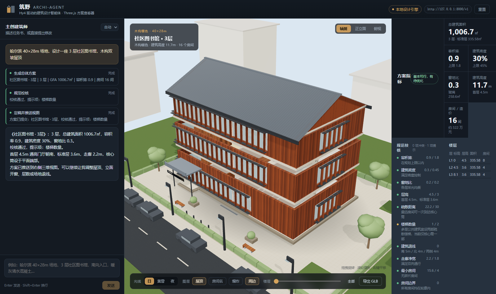
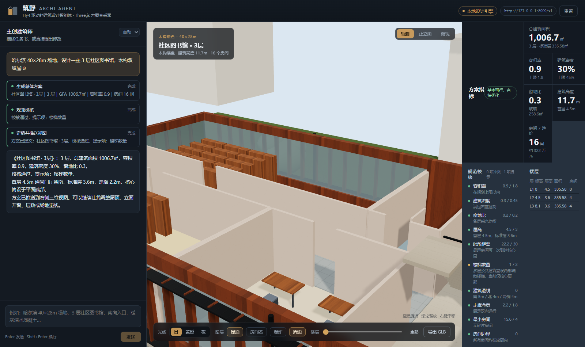
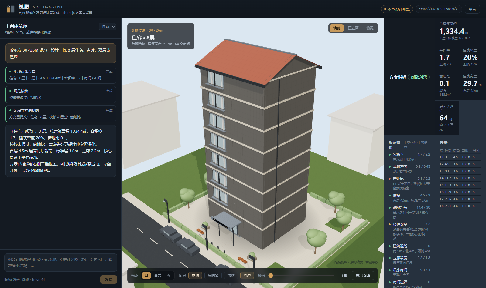

# 筑野 ARCHI-AGENT

参考开源 **Tencent Hunyuan Hy4**（`Tencent-Hunyuan/Hy4`）实现的**建筑设计智能体**示例：Hy4 做方案判断与工具编排，本地确定性「设计引擎」负责几何、指标与规范校核，Vue 3 + Three.js 负责把方案实时渲成三维模型。

```
            ┌───────────────────────────────────────────────┐
 任务书  →   │  Vue 3 对话面板（SSE 流式事件）                    │
            └───────────────┬───────────────────────────────┘
                            │ POST /api/chat
            ┌───────────────▼───────────────────────────────┐
            │ Agent Loop (server/src/agent/loop.js)          │
            │  • Hy4 (OpenAI 兼容 /v1, tool calling)          │
            │  • 不可用时退化为本地确定性规划器                  │
            └───────┬───────────────────────┬───────────────┘
                    │ 9 个设计工具            │ 回退/校验
      ┌─────────────▼─────────────┐  ┌──────▼────────────────┐
      │ Design Engine             │  │ DesignSpec (JSON)      │
      │ 程序化体量/楼层/立面/屋面   │→ │ metrics + code checks  │
      └───────────────────────────┘  └──────┬────────────────┘
                                            │
                            ┌───────────────▼───────────────┐
                            │ Three.js 查看器（程序化建模）    │
                            │ 楼板/墙/门窗/楼梯/屋面/标注      │
                            └───────────────────────────────┘
```










## 快速开始

一条命令完成初始化（装依赖 + 下载浏览器视觉模型 + 构建前端）：

```bash
npm run init
npm start               # http://127.0.0.1:8787
```

只想跑开发模式，不要模型：

```bash
npm run install:all     # 安装 web 依赖（server 零依赖）
npm run init -- --skip-model
npm run dev             # 同时启动 agent server (:8787) 与 Vite (:5173)
```

打开 <http://127.0.0.1:5173>。**不接模型也能完整跑通**：默认 `AGENT_MODE=auto`，探测不到 Hy4 时自动用本地规划器生成方案（同样会走 9 个工具，右侧可以看到工具时间线）。

只跑引擎自检：

```bash
npm run demo            # 生成一份方案并打印指标 / 规范校核
```

没有 GPU 也想验证 Hy4 那条链路？内置一个 OpenAI 兼容的 mock：

```bash
npm run test:hy4        # 启动 mock + agent，跑完整 tool-calling 循环并断言
```

它会依次触发 `design_scheme → edit_roof → check_codes → submit_design`，验证消息拼接、工具参数、Spec 合并与校验都能走通。手动体验：

```bash
npm run mock:hy4                                  # :8899 的假 Hy4
HY4_BASE_URL=http://127.0.0.1:8899/v1 AGENT_MODE=hy4 npm run dev
```

生产构建（server 直接托管静态文件，单端口 8787）：

```bash
npm run build && npm start
```

## 接入 Hy4

Hy4 是腾讯混元开源的 770B MoE 旗舰模型（49B 激活、1M 上下文），官方部署方式是 vLLM / SGLang 暴露 OpenAI 兼容接口，并用 `hy_v4` 解析工具调用。

```bash
# vLLM（官方镜像）
docker run --gpus all --privileged --ipc=host -p 8000:8000 \
  -v ~/.cache/huggingface:/root/.cache/huggingface \
  vllm/vllm-openai:hy4 tencent/Hy4-FP8 \
  --limit-mm-per-prompt '{"image":1,"video":0}' \
  --tensor-parallel-size 8 \
  --enable-auto-tool-choice \
  --reasoning-parser hy_v4 \
  --tool-call-parser hy_v4 \
  --served-model-name hy4 --port 8000
```

然后：

```bash
HY4_BASE_URL=http://127.0.0.1:8000/v1 HY4_MODEL=hy4 AGENT_MODE=hy4 npm run dev
```

Windows PowerShell：

```powershell
$env:HY4_BASE_URL="http://127.0.0.1:8000/v1"; $env:AGENT_MODE="hy4"; npm run dev
```

| 环境变量 | 默认 | 说明 |
| --- | --- | --- |
| `AGENT_MODE` | `auto` | `auto` 探测后回退 / `hy4` 优先走模型（失败仍会提示并回退） / `local` 纯本地 |
| `HY4_BASE_URL` | `http://127.0.0.1:8000/v1` | OpenAI 兼容地址 |
| `HY4_API_KEY` | `EMPTY` | vLLM 本地默认 EMPTY |
| `HY4_MODEL` | `hy4` | 与 `--served-model-name` 一致 |
| `HY4_REASONING` | `no_think` | `high` 开启长链推理（更慢、更深入） |
| `PORT` | `8787` | 服务端口 |

模型参数按官方推荐：`temperature=0.9`、`top_p=1.0`；`reasoning_effort` 通过 `chat_template_kwargs` 传入。

### 后端权重下载（本机实测）

项目提供可断点续传的 ModelScope 下载脚本，默认下载 `Tencent-Hunyuan/Hy4-FP8`：

```bash
npm run models:hy4:plan       # 只查询体积、磁盘、GPU，不下载
npm run models:hy4:config     # 只下 config / tokenizer / 分片索引（约 20 MB）
npm run models:hy4           # 全量权重；磁盘不足时直接拒绝并写 manifest
npm run models:hy4:check      # 查看本地文件与下载状态
```

本机实测结果（2026-11-22）：

| 项 | 结果 |
| --- | --- |
| 仓库 | `Tencent-Hunyuan/Hy4-FP8`，258 个文件 / 245 个权重分片 |
| 全量体积 | **732.33 GB** |
| 可用磁盘 | 202.8 GB（D 盘） |
| 显存 | RTX 3060 Laptop，6 GB；Hy4 FP8 常规部署需要 8 张 80GB 级 GPU |
| 实际下载 | 13 个配置文件，20 MB，落盘到 `server/data/models/Hy4-FP8/` |

结论：本机无法完整下载 770B 权重，脚本预检会拒绝全量下载，避免写满磁盘；配置已下好，后续换到大显存/大磁盘机器时可直接续传。单卡环境建议走 Hy4 的 OpenAI 兼容 API，或改用体积更小的 `Hy4-flash-FP8`（脚本支持 `--model=hy4-flash-fp8`）。

## 本地模型部署（不重启也能换模型）

除了环境变量，模型配置也可以直接在界面右上角的模型 chip 里改，写入 `server/data/settings.json`（tmp+rename 原子写），下次启动自动生效，优先级高于环境变量。

| `provider` | 指向 | 说明 |
| --- | --- | --- |
| `auto` | 先 Hy4 `:8000`，再 Ollama `:11434` | 探测不到就回退本地确定性引擎 |
| `hy4` | `MODEL_BASE_URL` / `HY4_BASE_URL` | 走 `chat_template_kwargs.reasoning_effort`、`tools` |
| `ollama` | `http://127.0.0.1:11434/v1` | 需 `ollama serve` + 一个 7B 级模型 |
| `openai` / `local` | 任意 OpenAI 兼容端点（llama.cpp / vLLM / LM Studio） | 不发 `reasoning_effort`，避免被拒 |

```bash
# 本机最轻的一条路径：Ollama
ollama pull qwen2.5:7b
ollama serve
# 然后在界面里选 ollama / 或：
MODEL_PROVIDER=ollama MODEL_NAME=qwen2.5:7b npm start
```

设置面板里的「测试连接」是 5s 探测（`/api/settings/test`），只验证 `/models` 或一次轻量补全能否返回，不代表模型会设计房子。`GET /api/health` 会回报 `provider / model / baseUrl / vision / visionModel / localVision? / hy4.reachable`。

## 系统日志

所有服务端事件写 JSON Lines，控制台同步输出，落盘到 `server/data/logs/system-YYYY-MM-DD.log`（保留 14 天）：

- `http`：每个请求的 method / path / status / 耗时 / 响应体大小 / IP；4xx 记 warn，5xx 记 error。
- `llm`：第三方模型探测、`/chat/completions` 请求与响应（provider、baseUrl、model、消息数、图片数、工具数、token usage、耗时、工具名），失败时记 HTTP 状态与响应体片段；apiKey、Authorization、图片 dataURL 自动脱敏，长文本截断。
- `agent`：引擎选择、Hy4 每一步、本地工具调用与耗时、工具参数/摘要、失败堆栈、回退原因。
- `chat` / `design` / `vision` / `session` / `settings`：会话轮次、参考图解析、方案生成、spec 导入、模型设置变更。
- `client`：浏览器未捕获异常、未处理 Promise rejection、API 请求失败、本地视觉 Worker 错误，经 `POST /api/client-log` 回传；与服务端 `http` 日志按时间对齐。服务端落盘时 `scope` 固定为 `client`，原始客户端分类保留在 `clientScope` 字段。
- `boot` / `process`：启动配置、SIGINT/SIGTERM、未捕获异常与未处理 Promise rejection。

查询最近日志：

```bash
curl "http://127.0.0.1:8787/api/logs?limit=200&level=warn&scope=llm"
```

环境变量：`ARCHI_LOG_LEVEL=info`（可设 `debug` 看请求开始与探测细节）、`ARCHI_LOG_KEEP_DAYS=14`、`ARCHI_LOG_DIR` 可改目录。

## 本地视觉模型（浏览器 WASM + 服务端 ONNX）

参考图不必再发给远端：项目内置一条完全在本机跑的视觉链路，模型下载到 `server/data/models/`，由同一个 8787 端口以 `/models/...` 提供，浏览器里用 onnxruntime-web 推理。

**选型（双模型，各司其职）**：

- **浏览器内**：`HuggingFaceTB/SmolVLM-500M-Instruct` 的 int8 ONNX 导出（`q8`，约 0.49 GB）。浏览器 WASM 堆只有 32 位 4 GB 上限，2B 级模型的权重加激活就会把渲染进程撑死（实测 Qwen2-VL-2B q8 在会话初始化阶段挂起），500M 模型能在 Web Worker 里稳定加载，几秒到几十秒出结果。
- **服务端兜底 / 高质量**：`onnx-community/Qwen2-VL-2B-Instruct`（`q8`，约 2.3 GB）。Node 没有 WASM 4 GB 天花板，可以吃满 2B 模型，中文描述和细节判断更好；浏览器链路不可用时由服务端视觉接管。

**下载 / 校验**：

```bash
npm run models:vision                 # 两个模型都下（q8，hf-mirror 优先，失败切 huggingface.co）
npm run models:vision:browser         # 只下浏览器用的 SmolVLM 500M
npm run models:vision:server          # 只下服务端用的 Qwen2-VL 2B
npm run models:check                  # 只校验文件大小，不下载
npm run models:vision -- --dry-run    # 打印机器信息、文件清单与总大小
npm run models:vision -- --dtype=q4f16
npm run models:vision -- --force      # 重新下载
```

脚本特性：按文件清单逐个下载，`.part` + HTTP Range 断点续传，4 秒进度行（百分比 / MB/s / ETA），`Content-Length` 校验，镜像失败自动换源重试，最后写 `manifest.json` 与 `models/index.json`。模型目录被 `.gitignore` 排除，不会进仓库。

**初始化**：

```bash
npm run init                 # 1 检查 Node 20+ 2 装 web 依赖 3 校验/下载模型 4 构建
npm run init -- --skip-model # 已有权重时跳过下载
```

`GET /api/vision/local` 返回是否安装、字节数、dtype 与缺失文件；`POST /api/settings` 里的 `provider.localVision=true` 打开开关（设置面板也有「浏览器本地视觉」勾选，未下载时禁用）。

**运行时行为**：

- 发消息带参考图且开关打开时，`web/src/vision/qwen.worker.js` 在 Web Worker 里加载 SmolVLM 500M（约 0.49 GB，从本机 `/models` 读，不发外网），把 JSON 开头 `{"programme":"` 预填进 chat template 强制模型续写结构化结果。
- 进度条会显示在输入框上方：阶段（读取 processor / 加载权重 / 推理）、总进度百分比、当前文件、已下载 / 总字节；模型只加载一次，后续图片复用同一个 session。
- Worker 的 `ready`、`stage`、`progress_total`、`error` 事件都会转成界面状态；加载失败会标红并显示原因，随后自动回退服务端视觉。
- 结果经 `/api/chat` 的 `analysis` 字段回传，服务端用 `adoptLocalAnalysis()` 按同一套枚举钳制 programme/style/floors，再拼任务书——模型胡说的值不会直接进生成器。
- 本地推理失败、超时（3 分钟）或返回非 JSON 时自动回退到服务端视觉 / 主色匹配，不阻塞对话。
- `npm run test:local-vision` 用同一份 `web/src/vision/smolVision.js` 在 Node（onnxruntime-node）里对 `docs/01-library-scheme.png` 跑一次真实推理并断言 JSON 结构；没有 GPU 也能验证下载、目录布局、chat template 与解析器。

## 参考图出方案

对话输入框左下角的「参考图」可以传一张图，前端先压到 1280px、并在图片中部采样 6 个主色（跳过天空过曝、阴影和植被像素），随后：

1. 若当前 provider 支持视觉（`/api/health` 的 `vision=true`），把图交给模型，要求一行 JSON：`{programme, style, floors, materials, description}`；
2. 否则（或模型返回不合规）用主色做加权 RGB 距离匹配最近的墙材风格（青砖→brick、木格栅→timber、铝/蓝玻→tech、白涂料→minimal、暖灰混凝土→concrete）；
3. 拼成任务书交给 Agent，**但用户在输入框里写的功能与层数优先**——写「做 6 层住宅」，参考图不会把它改成「4 层图书馆」。

参考图会落盘到 `server/data/refs/`，随会话一起恢复；`POST /api/reference` 可以只解析不生成方案。

视觉模型可以单独指定：设置面板「视觉模型」留空则复用主模型，填 `qwen2.5vl:7b` / `llava` 这类小模型即可让主模型（如 Hy4）专心做设计、视觉走另一条端点。解析结果会带 `analysis.source`（`vision` / `palette` / `default`）、`analysis.model` 和 `analysis.vision{enabled,reachable,used,reason}`，输入框上方的参考图条会显示「视觉 · 模型名」或「主色匹配」，悬停可看回退原因。没装真实 VLM 时可以用 `npm run mock:vision` + `npm run test:vision` 验证整条链路（会临时起一个 OpenAI 兼容 mock 和一个隔离的 API 实例，不碰本机设置）。

## 参数化提示词（prompt builder）

左栏对话页右上角「参数化提示词」打开参数面板：13 个字段分成「场地/地点」「功能/规模」「风格/屋顶」「附加要求」四组，改动任意一项，右侧就重新组合出任务书，并即时回显每一项是否被引擎识别。

| 参数 | 去向 |
| --- | --- |
| 城市 / 场地宽 / 进深 | 任务书首句 `哈尔滨 40×28m 场地`，被 `parseBrief` 的正则读成 `site` |
| 功能类型 / 层数 / 目标面积 | `design_scheme` 的 `programme`、`floors`、`area` |
| 立面风格 / 屋顶形式 / 坡度 / 顶层退台 | `style`、`roof`（平/双坡/单坡/四坡）、`pitch`、`stepped` |
| 气候区 | `climate`（严寒 / 温和 / 湿热），影响南向开窗与密度上限 |
| 细部做法（天窗、光伏、屋顶绿化、雨棚、坡道、通高门厅、竖向遮阳、夜景） | 只写进自然语言，由模型挑对应工具落地 |
| 其他要求 | 原样拼进「补充：…」，不影响结构化字段 |

组合规则落在 `server/src/design/promptParams.js`：`PARAM_SCHEMA` 是表单元数据（前端直接按它渲染，不硬编码选项），`composePrompt()` 负责拼句子并**反向自检**——把生成的提示词再喂给 `parseBrief`，逐字段比对，识别不出来的会进 `warnings`（例如选了四坡屋顶但正则只认双坡，就会提示出来）。所以「参数组合」和「引擎真正吃到的值」永远对得上。

内置的预设与快捷值：

- **21 组预设**，按功能分 6 类（社区图书馆 4 / 企业办公楼 4 / 住宅 4 / 美术馆 3 / 教学楼 3 / 社区中心 3），以 6 种经典风格作示例；风格库本身含 **17 种**（极简白 / 工业记忆 / 木构暖色 / 金属科技 / 砖砌传统 / 暖灰清水混凝土 / 北欧极简 / 日式木构 / 新中式 / 地中海 / 伊斯兰 / 热带东南亚 / 拉美 / 非洲夯土 / 草原学派 / 装饰艺术 / 阿尔卑斯石构），覆盖中国、日本、北欧、地中海、中东、东南亚、拉美、非洲、北美与高山地区；
- **26 个城市**（哈尔滨→严寒、北京/上海/杭州→温和、深圳/广州/厦门→湿热），`气候区=按城市自动` 时随城市改口，不用手选；
- **场地尺寸/面积/坡度快捷值**：宽 20/24/28/30/35/40/45/50/60/80，进深 18…50，面积 0/500/800/1200/2000/3000/5000/8000，坡度 0/15/22/30/35，点一下即填；
- **21 种细部做法**（天窗、光伏、屋顶绿化、屋顶露台、雨棚、坡道、无障碍电梯、通高门厅、采光中庭、下沉庭院、首层架空、竖向遮阳、双层挑檐、夜景、雨水花园、自行车棚、设备平台、太阳能集热、车库口、景观水池、儿童场地），只进自然语言、不带风格词，所以不会把用户选的立面风格冲掉。

```javascript
// 纯后端也能用
import { composePrompt } from './server/src/design/promptParams.js';
const { prompt, checks, warnings } = composePrompt({ city: '哈尔滨', programme: 'library', floors: 3, width: 40, depth: 28, style: 'timber', roof: 'gable' });
```

接口：

- `GET /api/prompt/params` → `{ schema, vocab }`
- `POST /api/prompt/build` → `{ prompt, params, segments, checks, warnings }`
- `POST /api/prompt/design` → 组合后直接跑 Agent，返回 `{ prompt, spec, digest, checks }`（默认接着当前会话，传 `reset:true` 才清空）

面板底部三个出口：复制、填入对话（作为草稿，可继续改字或附参考图）、直接生成方案（一次性出图并保留对话历史）。

## 成品库 / 回收站 / 风格分类

左栏三个页签：**对话 / 成品库 / 回收站**。

- 方案生成后点「存入当前方案」，会用 `ArchiViewer.captureThumbnail()` 抓一张 520px 的 JPEG 缩略图存进库；
- 每项带 `title / style / programme / tags / summary(GFA、FAR、密度、窗地比、层数、房间数、高度) / spec / thumb / reference`；
- 列表支持标题搜索、按「最新 / 最早 / 名称 / 面积」排序、**风格 chip 与功能 chip 双维过滤**（chip 上带命中数，0 命中自动置灰）；
- 删除是软删除（进 `trash.json`，缩略图与参考图保留），回收站可「恢复」或「彻底删除」（后者连 `thumbs/`、`refs/` 里的文件一起清掉），也可一键清空；
- 17 种风格：`极简白 / 工业记忆 / 木构暖色 / 金属科技 / 砖砌传统 / 暖灰清水混凝土 / 北欧极简 / 日式木构 / 新中式 / 地中海 / 伊斯兰 / 热带东南亚 / 拉美 / 非洲夯土 / 草原学派 / 装饰艺术 / 阿尔卑斯石构`；6 类功能：`社区图书馆 / 企业办公楼 / 住宅 / 美术馆 / 教学楼 / 社区中心`。从成品库「打开」会把 spec 回写到当前会话（`POST /api/spec`），后续编辑才对得上。

数据层：`server/data/{library,trash}.json`、`sessions/<sid>.json`（保留最近 30 轮对话 + 参考图 + spec）、`thumbs/`、`refs/`。这些运行数据不入库，`.gitignore` 已排除，仓库里只留 `.gitkeep`。

## 智能体的 9 个工具

模型只被允许通过工具改动方案，几何永远由引擎生成。

| 工具 | 作用 |
| --- | --- |
| `design_scheme` | 按任务书重生成总体方案（功能、层数、场地、风格、屋面） |
| `edit_roof` | 屋顶形式 / 坡度 / 出檐 / 女儿墙 / 屋面材料 |
| `edit_facade` | 立面体系（点窗 / 条窗 / 幕墙 / 格栅）、洞口尺寸、主材 |
| `edit_windows` | 按层 / 按房间调整采光面 |
| `edit_site` | 场地尺寸、退线、容积率与密度上限、气候区 |
| `set_floors` | 增减层数并重新排布 |
| `check_codes` | 规范自检，返回 pass / warn / fail |
| `submit_design` | 定稿并推送三维视图（可携带局部修改与设计说明） |
| *(内部)* `digest` | 每步回灌给模型的真实指标，避免模型编数字 |

**防幻觉设计**：`submit_design` 收到的任何面积、坐标、材料都会经 `normalizeAgentSpec()` 校验——越界房间会被裁剪，重叠房间整层回退到引擎布局，材料必须命中白名单，最后由 `metrics` 与 `checks` 单一来源计算。模型拿到的数值永远是工具返回值。

## 规范校核项

容积率、建筑密度、逐层窗地比、层高、疏散距离（到核心筒）、楼梯数量、退线、走廊净宽、最小房间面积、房间边界越界。

## DesignSpec 要点

```jsonc
{
  "site":    { "width": 40, "depth": 28, "setback": { "front": 5, "back": 4, "left": 4, "right": 4 } },
  "floors":  [ { "level": 1, "elevation": 0, "height": 4.5, "footprint": { "x": 5, "z": 9, "w": 24, "d": 14 },
                 "core": { "x": 25, "z": 10, "w": 4.5, "d": 6, "type": "stair" },
                 "rooms": [ { "name": "门厅", "type": "public", "x": 5, "z": 9, "w": 8, "d": 5, "windows": { "s": true } } ] } ],
  "facade":  { "system": "punched", "windowWidth": 1.8, "gap": 1.2, "sillHeight": 0.9, "align": true,
               "materials": { "wall": "warm-concrete", "glass": "bronze-glass" } },
  "massing": { "roof": { "type": "gable", "pitch": 26, "overhang": 0.6 } },
  "metrics": { "gfa": 1006.7, "far": 0.9, "coverage": 0.3, "windowFloorRatio": 0.2 },
  "checks":  [ { "id": "wfr", "name": "窗地比", "status": "pass" } ]
}
```

坐标：场地西北角为原点，`x` 向东、`z` 向南，单位米。`core` 为贯通核心筒，渲染器按踏步/梯段尺寸在每层结构楼板留出梯井洞口，保证楼梯落点与上一层楼面连通。`shared/facade.js` 里的开窗算法被服务端（算窗地比）和渲染器（画窗）共用，保证"指标和模型是同一份几何"。

## 目录

```
server/src/agent/     loop（双引擎）、llm（Hy4 客户端）、prompt、tools
server/src/design/    generator（程序化设计）、spec（校验合并）、rules（规范）、palette
shared/               facade.js：窗洞几何 + 面积，服务端与渲染器共用
web/src/scene/        ArchiViewer.js（编排）+ textures/batch/materials/facade/interior/roof/site 七个模块
web/src/components/   ChatPanel / SceneView / MetricsPanel
scripts/              dev.js（并行启动）、smoke.js（端到端自检）、mock-hy4.js + test-hy4-loop.js、mock-vision.js + test-vision.js
docs/                 运行截图
```

## 三维查看器

渲染分成七个模块，按"构造层"而不是"一个盒子 + 开洞"来建模：

- `textures.js`：canvas 程序化贴图（清水混凝土板缝/螺栓孔、错缝砖、石板缝、竖向木纹、直立锁边金属、广场砖、草地、沥青），`scaleBoxUV` 按每个面的真实尺寸缩放 UV，贴图不会被拉伸到整面墙。
- `batch.js`：同材质几何合并，几百个构件合成每材质一次 draw call。
- `materials.js`：spec 的材料名 → three 材质；玻璃升级为物理玻璃 `MeshPhysicalMaterial`：`transmission` 折射、`ior 1.52`、`thickness`、`attenuationColor` 玻璃厚度着色、clearcoat 清漆层、Fresnel 反射与 `envMapIntensity 1.8` 环境反射，同时保留夜间自发光；金属降低 metalness 并抬高 `envMapIntensity`，避免在 IBL 下变黑。
- `facade.js`：四套立面体系都带真实深度 —— 幕墙（0.45m 竖向 spandrel + 竖梃 + 横挺）、条窗（窗台/上口 + 中横档）、木格栅（外挑 0.34m 竖向鳍片 + 上下横档）、点窗（0.3m 深洞口 + 石质窗套/窗台 + 宽窗中梃）；另有落水管、外露柱廊、入口雨棚 + 三级台阶 + 双扇玻璃门 + 招牌。点窗按整面立面的统一开间轴网排布（`facade.align=true`），上下层窗洞共用同一轴线，不会因房间划分不同而错位。
- `interior.js`：内隔墙（带门洞）、核心筒（踏步 + 休息平台 + 栏杆 + 电梯井与厅门）、按房间类型的家具（书架、阅览桌 + 椅、办公桌组、会议长桌、接待台、展板、课桌、床/沙发、湿区隔断、机柜）。核心筒楼梯在各层对位，上部楼层结构楼板按梯段尺寸留出梯井洞口，楼梯可以真正通到上一层。
- `roof.js`：平屋顶女儿墙 + 金属压顶 + 屋面机组/风管/采光天窗/雨水口/光伏阵列；坡屋顶脊瓦 + 檐口封边 + 天沟 + 山墙封板；退台形成的屋顶露台木平台 + 玻璃栏板。
- `site.js`：场地铺地、南侧街道与斑马线、绿化带/绿篱、乔木（树干 + 多层树冠）、长椅、阻车柱、路灯、停车、入口步道、接触阴影、用地红线。
- 交互：轴测 / 正立面 / 俯视，日 / 黄昏 / 夜（夜间玻璃自发光），屋顶、房间名、错层展示（水平错开距离、竖向抬升、错开方向均可在「内部」页签调，默认每层沿屏幕右下方向错开 3.8m 并抬升 1.8m；最低楼层固定不动——无地下室时是首层，有地下室时是最底层地下室）、周边体量、线框、楼层隔离滑杆；导出 **GLB**（只导出可见节点，删掉的构件不会进文件）。

右栏检查器（`MetricsPanel`）分五个页签：

- **指标**：GFA / 容积率 / 密度 / 窗地比 / 高度 / 造价、规范校核、楼层表、立面配置、设计说明，另有场景统计（三角面、材质数、draw call、光源数、隐藏节点、线框开关）。
- **节点**：按语义组织的节点树（场地与景观 → 建筑主体 → 各层 → 材质桶 → 房间名 / 周边体量），点一行就在三维里用金色 `BoxHelper` 高亮，并展开尺寸、三角面、子节点、楼层、材质键；行内可隐藏/删除，工具条有撤销 / 重做 / 恢复（栈上限 120 步，楼层隔离和屋顶开关不会把删掉的节点"复活"）。
- **光照**：时间预设（日 / 黄昏 / 夜）、方位角、高度角、太阳强度、天光、补光、环境贴图、曝光、阴影（关 / 柔和 2048 / 高精度 4096）、夜间室内灯，全部实时生效。
- **剖切**：开启后用 Three.js 局部裁剪面剖切建筑主体：横向 X / 水平 Y / 纵剖 Z 三个正交方向，外加任意角度的「斜剖」（0–360° 角度滑杆）；「正向 + / 反向 −」切换保留侧时只翻转保留半区，剖切面位置保持不动；Y 向正向保留下部楼层、反向保留上部楼层。滑杆 0–100% 实时移动（不重建模型），也可在舞台上直接拖动剖切面；「划线定角」在场地点两下即按线段方向生成任意角度剖切（优先拾取建筑表面，自动把保留侧朝向远离相机的一侧），并在运行中显示青色辅助线。剖切面用淡橙薄面 + 细网格 + 边框表示，剖切时自动收起房间名标注，周边体量与场地保持完整，便于对照环境。裁剪只作用于材质，不影响节点选择、撤销 / 重做与 GLB 导出。舞台工具栏的「线框 / 剖切 / 剥离」与右栏开关双向联动。
- **内部**：「剥离外墙 / 屋面」隐藏墙体、玻璃、窗框、压顶与屋面材质桶，保留楼板、隔墙、家具与楼梯，直接看内部布局；「内部灯具发光」把房间与走廊灯具切换为强自发光，并叠加加法混合光晕，在黄昏 / 夜晚预设下最明显。**错层展示**可调水平错开（0–8m/层）、竖向抬升（0–6m/层）和错开方向（0–360°），调参数时自动开启，最低楼层始终钉在原地；楼层联通性测试沿「入口 → 首层走廊 → 各层楼梯 → 顶层中心」生成 CatmullRom 路径，橙色管道穿透墙体绘出完整 path，发光小球按路径滚动（约 3.6 m/s，右栏显示路径点数与实时进度）；错层开启或参数变化时，路径控制点按所属楼层同步位移，橙色管道与小球一起跟着楼层分开，不会留在原位。

开窗口径仍由 `shared/facade.js` 统一计算，所以立面上的玻璃面积和右栏"窗地比"永远对得上。`facade.align` 为 true（默认）时，窗洞先按整面立面生成统一开间轴网，再裁到有采光需求的房间段；同一立面上下层共用同一组轴线。

## 已知边界

- 平面为矩形标准层 + 走廊 + 端部核心筒的规则布局，不支持异形/L 形平面、坡地、幕墙分格详图。
- 「规范」是可解释的规则近似（疏散距离用曼哈顿距离、楼梯数量按层数与面积判断），不是地方规范条文库，不可直接用于报建。
- 单进程内存会话（按浏览器 `sid` 隔离），无持久化与多用户权限。

## 许可与致谢

Hy4 权重与代码遵循 Tencent Hy License / Apache 2.0（见官方仓库）；本项目仅为架构示例。
